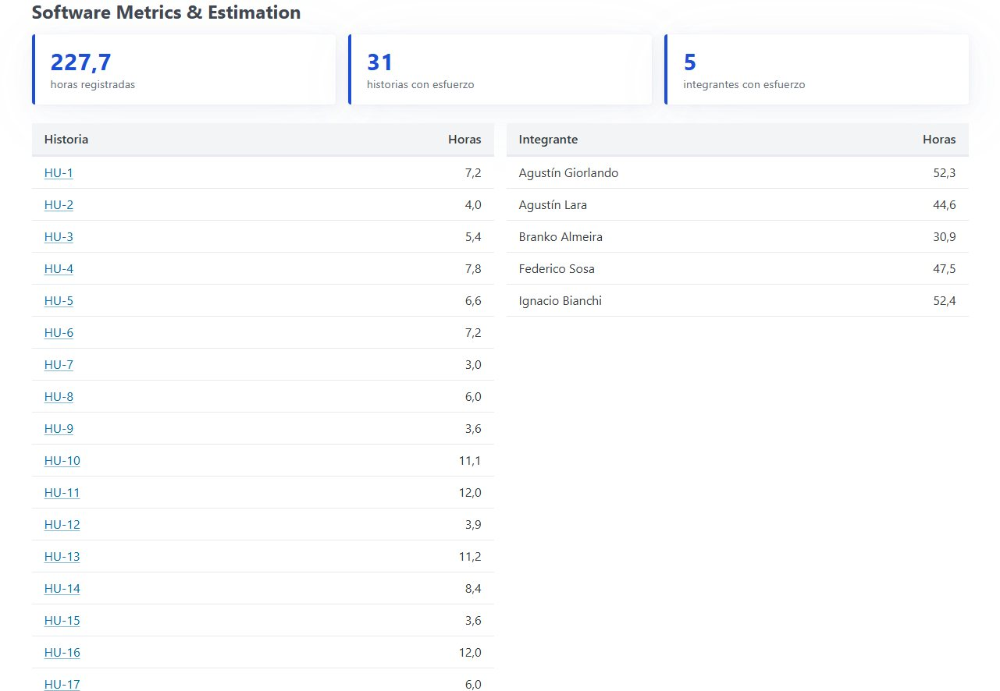
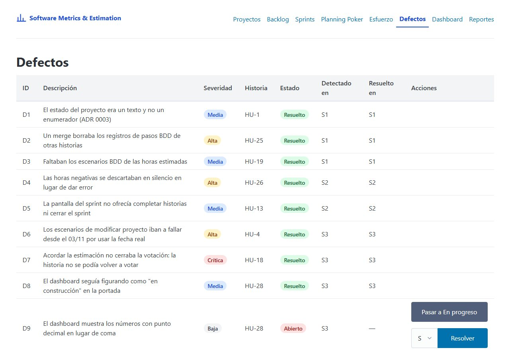

# Manual de usuario · Software Metrics & Estimation

> Plantilla de TEC-07. Cada responsable completa la sección de su épica, y Branko completa la introducción y la
> documentación técnica. Escribí para alguien que nunca usó la app: qué puede hacer, paso a paso y con las reglas
> que va a encontrar (mensajes de error incluidos). Una o dos capturas por sección como máximo, en
> `docs/manual/img/`.

## 1. Primeros pasos — Branko Almeira

<!-- Cómo levantar la app (make run / make demo), la navegación y qué hay en la portada. -->

## 2. Proyectos e integrantes (E1) — Federico Sosa

Todo empieza por un proyecto: el backlog, los sprints, el esfuerzo y los defectos son siempre de un proyecto. En la
navegación, **Proyectos** muestra la lista de proyectos con sus fechas y su estado.

### Crear un proyecto

1. En **Proyectos**, tocá **Nuevo proyecto**.
2. Completá el **nombre**, una **descripción** (opcional) y las **fechas de inicio y de fin**.
3. Tocá **Crear proyecto**. La app te lleva al detalle del proyecto nuevo.

Si algo no cumple las reglas, el formulario vuelve con lo que escribiste y el motivo:

| Regla | Mensaje |
|---|---|
| El nombre tiene entre 3 y 100 caracteres (los espacios del principio y del final no cuentan) | "el nombre debe tener entre 3 y 100 caracteres" |
| La fecha de fin no es anterior a la de inicio (pueden ser el mismo día) | "la fecha de fin no puede ser anterior a la de inicio" |
| No hay dos proyectos con el mismo nombre, sin importar mayúsculas ("Demo" y "demo" son el mismo) | "ya existe un proyecto con ese nombre" |

### El estado del proyecto

El estado **no se cambia a mano**: sale de las fechas del proyecto y del día de hoy.

| Estado | Cuándo |
|---|---|
| **Planificado** (gris) | Todavía no llegó la fecha de inicio |
| **En curso** (azul) | Entre el inicio y el fin, los dos días incluidos |
| **Finalizado** (verde) | Ya pasó la fecha de fin |

### Ver el estado del proyecto de un vistazo

Al abrir un proyecto, el detalle muestra arriba su estado y sus fechas, y tres tarjetas:

- **Días restantes:** los días que faltan hasta la fecha de fin, sin contar hoy. El último día y en un proyecto
  finalizado es 0.
- **Sprint activo:** el sprint que está en curso, con un enlace para abrirlo. Si no hay ninguno, dice "Ninguno".
- **Historias completadas:** el porcentaje de historias del backlog del proyecto que ya están completadas. Sin
  historias es 0,0 %.

### Modificar un proyecto

1. En el detalle del proyecto, tocá **Editar proyecto**. Se abre el mismo formulario del alta, con los datos cargados.
2. Cambiá el nombre, la descripción o las fechas y tocá **Guardar cambios**.

Valen las mismas reglas que al crearlo. Además:

- Podés dejar el mismo nombre o cambiarle solo las mayúsculas, pero no ponerle el nombre de **otro** proyecto
  ("ya existe un proyecto con ese nombre").
- **Un proyecto finalizado no se puede modificar** ("un proyecto finalizado no se puede modificar"). Tampoco se puede
  "reabrir" corriéndole la fecha de fin: se mira cómo está hoy, no cómo quedaría con los cambios.

### Registrar integrantes

En el detalle del proyecto, la sección **Integrantes** muestra quiénes forman el equipo y su rol. Para sumar a alguien:

1. Escribí su **nombre** y elegí el **rol**: Agile Enabler, Product Builder o Product Architect.
2. Tocá **Registrar integrante**.

| Regla | Mensaje |
|---|---|
| El nombre es obligatorio | "el nombre del integrante es obligatorio" |
| El rol es uno de los tres de la lista | "el rol debe ser Agile Enabler, Product Builder o Product Architect" |
| Una persona no se registra dos veces en el mismo proyecto, sin importar mayúsculas | "el integrante ya está registrado en el proyecto" |

Una misma persona puede ser integrante de varios proyectos. Los integrantes son los que después votan en el Planning
Poker y cargan horas.

Si abrís un proyecto que no existe (por ejemplo, un enlace viejo), la app muestra "el proyecto no existe".

## 3. Product Backlog (E2) — Ignacio Bianchi y Agustín Lara

La pantalla **Backlog** (`/backlog`) agrupa las historias por proyecto y las lista en una tabla: el ID, el título
(que lleva al detalle), la prioridad y el estado como insignias de color, los Story Points (o "—" si no está
estimada) y la cantidad de criterios. Con **Nueva historia** entrás al formulario de alta.

### Crear una historia (HU-05) — Ignacio Bianchi

1. En Backlog, tocá **Nueva historia**.
2. Elegí el proyecto, escribí el título (obligatorio), la descripción (opcional) y la prioridad (Alta, Media o Baja).
3. Tocá **Crear historia** y volvés al listado, donde la nueva historia ya aparece.

La aplicación asigna el identificador automáticamente (`HU-1`, `HU-2`, …) y es **único en todo el sistema**: no se
reinicia por proyecto. La historia nace en estado *Pendiente*, sin Story Points y sin criterios.

Mensajes de error que puede mostrar: "el título es obligatorio" si el título está vacío, y "el proyecto no existe".

### Criterios de aceptación de una historia (HU-07) — Ignacio Bianchi

En el detalle de la historia, la sección **Criterios de aceptación**:

- **Agregar:** escribí el criterio en el campo "Nuevo criterio de aceptación" y tocá **Agregar**. Queda al final de
  la lista, que se numera sola empezando en 1.
- **Quitar:** tocá **Quitar** en la fila del criterio. Los que quedan se renumeran (si quitás el 2 de tres criterios,
  el 3 pasa a ser el 2).

El texto no puede estar vacío: si lo está, la pantalla avisa "el criterio de aceptación no puede estar vacío".
Una historia **sin criterios todavía no está lista para un sprint**: lo rechaza al querer asignarla (HU-11, Sprints).

### Cambiar el estado de una historia (HU-08) — Ignacio Bianchi

En el detalle, el desplegable **Estado** con el botón **Cambiar estado**. Los estados van Pendiente → En progreso →
Completada, con transiciones controladas:

| Pasa de | A | Condición |
|---|---|---|
| Pendiente | En progreso | La historia tiene que estar asignada a un sprint |
| En progreso | Pendiente | Libre: se puede volver atrás |
| Pendiente o En progreso | Completada | Asignada a un sprint |

*Completada* es final: la historia ya no cambia de estado. Para completarla desde la aplicación se usa el botón
**Completar** de la pantalla del sprint (HU-12), para que el sprint lo registre.

Errores que puede mostrar: "no se puede pasar de Pendiente a Completada" (sin sprint) o el par de estados
correspondiente, y "la historia debe estar asignada a un sprint".

### Estimar una historia en Story Points (HU-15) — Ignacio Bianchi

En el detalle, el desplegable **Story Points** con la escala 1, 2, 3, 5, 8, 13, 21 y el botón **Estimar**. Ese valor
es el tamaño de la historia y alimenta las métricas de los sprints (E7).

- Una historia estimada se puede **re-estimar** cuantas veces haga falta mientras no esté completada.
- Una completada no: si lo intentás, la pantalla avisa "no se puede re-estimar una historia completada".
- También se puede acordar el valor con el equipo en el Planning Poker (sección 5): es la misma operación de fondo.

### Editar y eliminar una historia (HU-06) — Agustín Lara

Al final del detalle de la historia, la sección **Editar** trae el formulario con el título, la descripción y la
prioridad que tiene hoy.

- **Editar:** cambiá lo que necesites y tocá **Guardar cambios**. Solo se editan esos tres datos: el estado, los
  Story Points y los criterios tienen su propia sección. Valen las reglas del alta: el título es obligatorio y la
  prioridad es Alta, Media o Baja. Una historia asignada a un sprint se puede editar mientras no esté completada.
- **Eliminar:** tocá **Eliminar** y volvés al backlog, donde la historia ya no aparece. La app **no pide
  confirmación**: revisá antes de tocarlo. El ID de una historia eliminada no se vuelve a usar (si borrás la HU-3,
  la próxima historia nueva no es la HU-3).

| Regla | Mensaje |
|---|---|
| El título es obligatorio | "el título es obligatorio" |
| La prioridad es Alta, Media o Baja | "la prioridad debe ser Alta, Media o Baja" |
| Una historia completada no se edita: ya es parte del resultado de un sprint | "una historia completada no se puede editar" |
| No se elimina una historia completada | "no se puede eliminar una historia completada" |
| No se elimina una historia asignada a un sprint (primero hay que quitarla del sprint) | "no se puede eliminar una historia asignada a un sprint" |
| No se elimina una historia con horas o defectos cargados: quedarían registros sin historia | "no se puede eliminar una historia con esfuerzo o defectos registrados" |

### Ver el backlog ordenado y filtrar por estado (HU-09) — Agustín Lara

La pantalla **Backlog** muestra el backlog de cada proyecto en el orden en que conviene trabajarlo, para saber qué
sigue:

1. Primero por **prioridad**: Alta, después Media y al final Baja.
2. A igual prioridad, por **número de historia**: HU-2 va antes que HU-10.

Arriba de la lista, el desplegable **Todos / Pendiente / En progreso / Completada** con el botón **Filtrar** deja
solo las historias de ese estado, en el mismo orden. Por ejemplo, **Pendiente** muestra lo que todavía no se empezó.
Para volver a ver todo, elegí **Todos**.

- Un proyecto sin historias, o sin ninguna en el estado elegido, no aparece en la lista. Si no queda ninguno, la
  pantalla dice "No hay historias en el backlog." con un enlace para crear la primera.
- Si la dirección trae un estado que no existe (por ejemplo, un enlace mal copiado), la app avisa "el estado debe ser
  Pendiente, En progreso o Completada".

## 4. Sprints (E3) — Federico Sosa

Un sprint es una iteración del proyecto con fechas y un objetivo (el **Sprint Goal**). En la navegación, **Sprints**
muestra, por cada proyecto, sus sprints con su estado y, más abajo, los **sprints cerrados** con sus resultados.

El ciclo de un sprint es siempre el mismo:

| Estado | Qué significa | Qué se puede hacer |
|---|---|---|
| **Planificado** (gris) | Recién creado | Asignarle historias e **iniciarlo** |
| **Activo** (azul) | En curso | Asignar historias, **completarlas** y **cerrarlo** |
| **Cerrado** (verde) | Terminado: su resultado queda guardado | Solo consultarlo |

### Crear un sprint

1. En **Sprints**, tocá **Nuevo sprint** en el proyecto que corresponda (ya viene elegido en el formulario).
2. Escribí el **Sprint Goal** y las **fechas de inicio y de fin**.
3. Tocá **Crear sprint**. La app te lleva al detalle del sprint, en estado Planificado.

| Regla | Mensaje |
|---|---|
| El Sprint Goal es obligatorio | "el Sprint Goal es obligatorio" |
| La fecha de fin no es anterior a la de inicio | "la fecha de fin no puede ser anterior a la de inicio" |
| Las fechas están dentro de las del proyecto (puede empezar el día de inicio y terminar el día de fin) | "las fechas del sprint deben estar dentro de las del proyecto" |
| No comparte ningún día con otro sprint del mismo proyecto (sí puede empezar el día siguiente al fin del otro) | "las fechas se superponen con otro sprint del proyecto" |

### Asignar historias al sprint (armar el Sprint Backlog)

En el detalle del sprint, **Asignar una historia del backlog** ofrece las historias del proyecto que todavía no están
en ningún sprint. Elegí una y tocá **Asignar al sprint**. La historia aparece en la tabla **Historias del sprint** con
sus Story Points.

Solo entran historias **listas para trabajar**. Si no lo están, la app lo dice:

| Regla | Mensaje |
|---|---|
| La historia está estimada (tiene Story Points) | "la historia no está estimada" |
| Tiene al menos un criterio de aceptación | "la historia no tiene criterios de aceptación" |
| No está en otro sprint (ni dos veces en el mismo) | "la historia ya está asignada a un sprint" |
| No está completada | "la historia ya está completada" |
| El sprint no está cerrado | "el sprint está cerrado y no se puede modificar" |

Para estimar una historia o agregarle criterios, andá al **Backlog** (sección 3) o al **Planning Poker** (sección 5).

### Iniciar el sprint

En un sprint planificado, tocá **Iniciar sprint**. Solo puede haber **un sprint activo por proyecto**: si ya hay otro,
la app responde "ya hay un sprint activo en el proyecto". Un sprint que ya está activo o cerrado no se vuelve a
iniciar ("solo se puede iniciar un sprint planificado").

### Completar historias

Mientras el sprint está activo, cada historia de la tabla tiene el botón **Completar**. Al tocarlo, la historia queda
como **Completada** (verde) y sus Story Points pasan a contar como completados en el sprint. Una historia
completada no se vuelve a completar.

### Métricas del sprint

Arriba del detalle, cuatro tarjetas resumen cómo va el sprint:

- **Story Points planificados:** la suma de los SP de las historias del sprint.
- **Story Points completados:** la suma de los SP de las historias completadas.
- **Historias completadas:** el porcentaje, con cuántas son de cuántas.
- **Velocidad del equipo:** el promedio de SP completados de los sprints **cerrados** del proyecto (el sprint en curso
  todavía no cuenta).

Qué significa cada métrica en detalle está en la sección 8.

### Cerrar el sprint

En un sprint activo, tocá **Cerrar sprint**. Al cerrarlo:

- quedan fijos sus Story Points planificados y completados, que pasan a contar para la velocidad del equipo;
- las historias que **no** se completaron vuelven al backlog como Pendientes y sin sprint, listas para planificarse en
  el próximo;
- el sprint ya no se puede modificar ("el sprint está cerrado y no se puede modificar").

Solo se cierra un sprint activo: uno que nunca se inició no se puede cerrar ("solo se puede cerrar un sprint activo").

### Consultar los sprints anteriores

En **Sprints**, debajo de los sprints de cada proyecto, **Sprints cerrados** lista los que ya terminaron, del más
antiguo al más reciente, con sus fechas, su Sprint Goal y los Story Points planificados y completados. Al abrir uno
se ven todas las historias que se planificaron: las completadas y las que volvieron al backlog
(**No completada**, en gris).

Si abrís un sprint que no existe, la app muestra "el sprint no existe".

## 5. Planning Poker (E4) — Ignacio Bianchi

La pantalla **Planning Poker** (`/planning-poker`) muestra todas las historias del backlog en dos tablas:
**Pendientes** (las que se pueden votar) y **Completadas** (no se votan, y si tenían estimación la muestran).
La regla de la votación es que las cartas quedan **ocultas** hasta que alguien las revela: mientras la votación está
abierta, cada fila solo muestra "Votaron: …" con los nombres de quienes ya votaron.

La aplicación no tiene login: el equipo se entiende eligiendo el nombre en la lista ("Votás como…"). Es una
limitación aceptada para una herramienta interna, y solo votan los integrantes del proyecto de la historia.

### Abrir una votación

En la fila de la historia, tocá **Abrir votación** (o **Abrir nueva votación** si ya había una estimación de antes).
La votación arranca en la ronda 1, sin votos. Una historia solo puede tener una votación abierta a la vez; si la
historia está completada, no se puede abrir ("no se puede votar una historia completada").

### Votar

Elegí tu nombre en "Votás como…" y tocá una carta: 1, 2, 3, 5, 8, 13 o 21, los botones de la fila. El valor queda
registrado sin mostrarse, y tu nombre pasa a la lista "Votaron: …" (mientras nadie votó, muestra "Votaron: todavía
nadie"). Cada integrante vota **una vez por ronda**: si lo intentás de nuevo, la pantalla avisa "el integrante ya
votó en esta ronda".

### Revelar los votos

Cuando ya votaron, en la fila aparecen "Revelo como…" y el botón **Revelar votos**. La revelación es tarea del
Agile Enabler: si el proyecto no tiene uno, la fila lo avisa con "Se necesita Agile Enabler". Al revelar se muestran
todos los votos de la ronda (integrante y carta) y:

- si coinciden, una insignia de éxito: "Hay consenso en 5." (un único voto también es consenso);
- si no, la diferencia: "No hay consenso: el voto más alto es 8 (…) y el voto más bajo es 2 (…)", con quiénes votaron
  cada extremo. Esos dos grupos son los que explican su voto antes de la próxima ronda.

Después de revelar, la ronda cierra: no acepta votos ("la ronda ya fue revelada").

### Nueva ronda (si falta acuerdo)

Si no hubo consenso, se discute y tocá **Nueva ronda**: la ronda actual pasa al historial (el desplegable "Historial
de rondas" muestra cada una con sus votos) y arranca la siguiente, sin votos, para volver a votar. Solo se puede abrir
una ronda nueva después de revelar la actual: si no, avisa "primero hay que revelar los votos de la ronda".

### Registrar la estimación acordada

Cuando el equipo se pone de acuerdo, elegí el valor en el desplegable **Estimar** y tocá **Registrar**. Puede ser
cualquier valor de la escala, aunque nadie lo haya votado. La historia queda con esos Story Points y la votación se
**cierra**: la fila pasa a mostrar "Estimación acordada: 5 SP" y aparece **Abrir nueva votación** por si más
adelante hay que re-estimarla.

### Las reglas, en corto

- Una sola votación abierta por historia; no se ve el valor de ningún voto antes de revelar.
- Una carta por integrante por ronda; la revelación es del Agile Enabler.
- Las cartas y la estimación acordada siempre son valores de la escala: 1, 2, 3, 5, 8, 13 o 21
  ("los Story Points deben ser 1, 2, 3, 5, 8, 13 o 21").
- "Primero hay que revelar los votos de la ronda" aparece si se quiere acordar o abrir ronda antes de tiempo;
  "no hay votos para revelar", si nadie votó todavía.

## 6. Esfuerzo (E5) — Agustín Lara

La pantalla **Esfuerzo** (`/esfuerzo`) junta todo lo que tiene que ver con horas: el formulario para cargar las
horas trabajadas, la lista de lo cargado, el esfuerzo de cada proyecto y las horas estimadas de cada historia. Las
horas se escriben y se muestran con coma decimal (1,5 es una hora y media), aunque los formularios también aceptan
punto.

### Registrar horas trabajadas (HU-20)

1. En **Registrar horas trabajadas**, elegí el **integrante** (al lado del nombre figura su proyecto) y la
   **historia** en la que trabajó.
2. Completá la **fecha** (viene cargada la de hoy), la **actividad** (por ejemplo, Desarrollo, Tests o Revisión de
   PR) y las **horas**. Se aceptan fracciones, como 0,5 o 2,5.
3. Tocá **Registrar horas**. El registro aparece en la lista **Horas registradas**, agrupado por historia.

Si algo no cumple las reglas, el formulario vuelve con lo que escribiste y el motivo:

| Regla | Mensaje |
|---|---|
| La actividad es obligatoria | "la actividad es obligatoria" |
| La fecha es obligatoria | "la fecha es obligatoria" |
| Las horas son mayores que cero | "las horas deben ser mayores que cero" |
| La fecha no puede ser futura (hoy sí vale) | "la fecha no puede ser futura" |
| Una persona no carga más de 24 horas en un mismo día, sumando todos sus registros de ese día | "el integrante superaría las 24 horas en ese día" |
| El integrante tiene que ser del proyecto de la historia | "el integrante no pertenece al proyecto de la historia" |

### Consultar el esfuerzo de un proyecto (HU-21)

En **Esfuerzo por proyecto**, cada proyecto tiene su bloque con tres tarjetas:

- **Horas registradas:** el total de horas cargadas en las historias del proyecto.
- **Historias con esfuerzo:** cuántas historias tienen al menos un registro.
- **Integrantes con esfuerzo:** cuántas personas cargaron horas.

Debajo, dos tablas con el detalle: las horas **por historia** (en orden de número, con un enlace a cada una) y las
horas **por integrante** (en orden alfabético). Las dos suman lo mismo que la tarjeta de horas registradas. Un
proyecto sin horas cargadas muestra "Todavía no hay esfuerzo registrado." con un enlace al formulario.

### Estimar las horas de una historia (HU-19)

En **Horas estimadas por historia**, cada historia del backlog tiene un campo para escribir cuántas horas se calcula
que va a llevar y el botón **Guardar**. Las que todavía no tienen estimación dicen "Sin estimar".

- Una historia tiene **una sola** estimación de horas: si guardás otra, reemplaza a la anterior.
- Las horas tienen que ser mayores que cero ("las horas deben ser mayores que cero"). El error aparece en la fila de
  esa historia.
- Es distinta de los Story Points: los Story Points miden el tamaño relativo (sección 3) y las horas estimadas se
  comparan con las horas reales en las métricas (sección 8).

## 7. Defectos (E6) — Agustín Lara

La pantalla **Defectos** (`/defectos`) lista los defectos encontrados, con su severidad y su estado como insignias de
color, y abajo tiene el formulario para registrar uno nuevo.

### Registrar un defecto (HU-22)

1. En **Registrar defecto**, escribí la **descripción** del problema.
2. Elegí la **severidad** (Crítica, Alta, Media o Baja), la **historia** en la que apareció y el **sprint de
   detección**, es decir, el sprint en el que se encontró.
3. Tocá **Registrar defecto**. Aparece en la lista con un ID (`D1`, `D2`, …) y en estado **Abierto**.

Se puede registrar un defecto en una historia ya completada (suele ser justo cuando aparecen) y en un sprint ya
cerrado, si se encontró en ese sprint y se carga tarde.

| Regla | Mensaje |
|---|---|
| La descripción es obligatoria | "la descripción es obligatoria" |
| La severidad es una de las cuatro de la lista | "la severidad debe ser Crítica, Alta, Media o Baja" |
| El sprint de detección es del mismo proyecto que la historia | "el sprint de detección no pertenece al proyecto de la historia" |

Las insignias de severidad van de más grave a menos grave: **Crítica** en rojo, **Alta** en ámbar, **Media** en
azul y **Baja** en gris.

### Seguir y resolver un defecto (HU-23)

Un defecto pasa por tres estados:

| Estado | Qué significa | Insignia |
|---|---|---|
| **Abierto** | Se encontró y nadie lo está corrigiendo | Rojo |
| **En progreso** | Alguien lo está corrigiendo | Ámbar |
| **Resuelto** | Ya se corrigió, en un sprint de resolución | Verde |

En la columna **Acciones** de cada defecto:

- **Pasar a En progreso / Pasar a Abierto:** mueve el defecto entre esos dos estados, para cualquiera de los dos
  lados.
- **Resolver:** elegí el **sprint de resolución** en el desplegable y tocá **Resolver**. Se puede resolver desde
  Abierto o desde En progreso. El desplegable solo ofrece los sprints del mismo proyecto que no empiezan antes que el
  de detección, y puede ser el mismo sprint.

**Resuelto es final:** un defecto resuelto ya no ofrece acciones y no vuelve a cambiar de estado. Si la app rechaza
un cambio, avisa con alguno de estos mensajes:

| Situación | Mensaje |
|---|---|
| Cambiar un defecto resuelto o pasarlo al estado que ya tiene | "no se puede pasar de Resuelto a Abierto" (con los estados que correspondan) |
| El sprint de resolución es de otro proyecto | "el sprint de resolución no pertenece al proyecto del defecto" |
| El sprint de resolución empieza antes que el de detección | "el sprint de resolución no puede ser anterior al de detección" |

## 8. Métricas y dashboard (E7 y E8) — Agustín Giorlando

<!-- Qué significa cada métrica (SP, velocidad, %, horas, desviación, defectos) y cómo leer el dashboard
     (HU-24 a HU-28). -->

## 9. Reportes y exportación a PDF (E9) — Agustín Giorlando

<!-- Reporte de sprint y de proyecto, y cómo guardarlos como PDF (HU-29 a HU-31). -->

## Anexo · Documentación técnica — Branko Almeira

<!-- Arquitectura (ADR 0001 a 0004), estructura de paquetes, cómo correr, cómo probar (make test, make cover,
     BDD), CI, cómo contribuir: SDD → BDD → TDD, resolución de conflictos en los archivos compartidos y chequeo de
     `Closes #N` antes de abrir un PR (acciones pendientes de las retros). -->
