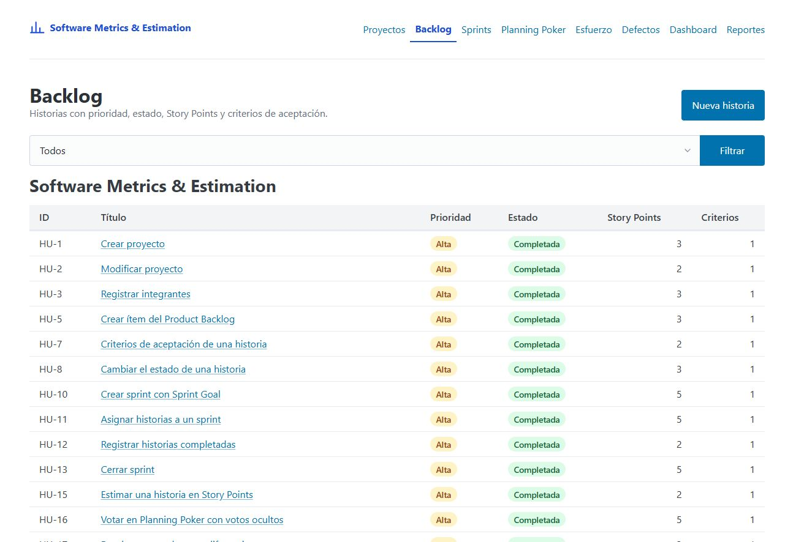
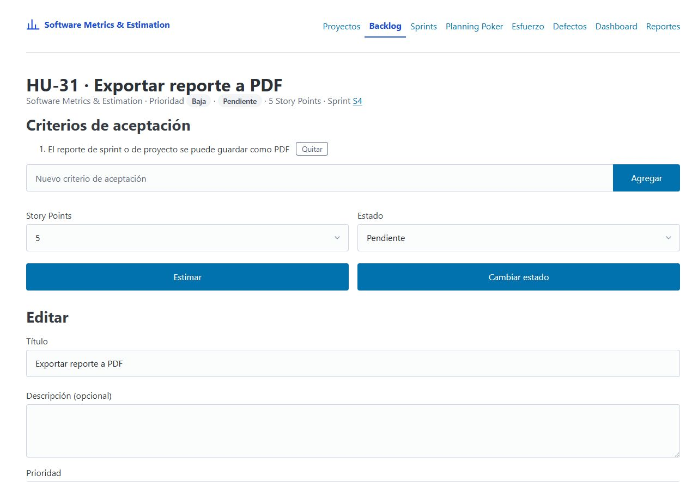
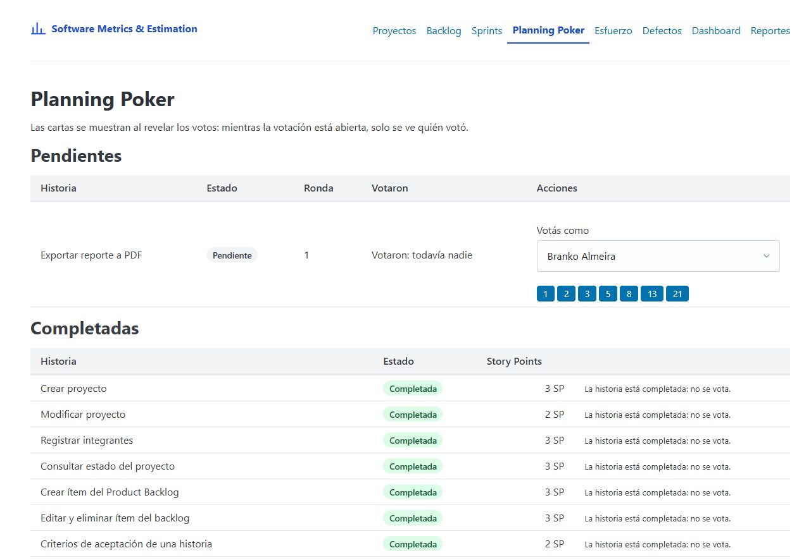
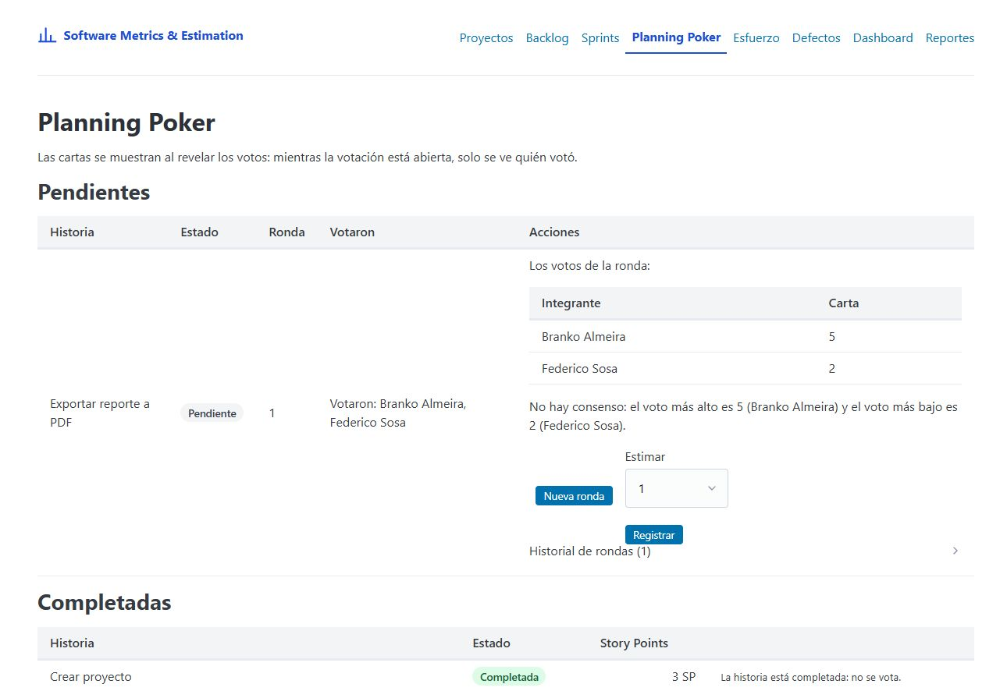

# Manual de usuario · Software Metrics & Estimation

> Plantilla de TEC-07. Cada responsable completa la sección de su épica, y Branko completa la introducción y la
> documentación técnica. Escribí para alguien que nunca usó la app: qué puede hacer, paso a paso y con las reglas
> que va a encontrar (mensajes de error incluidos). Una o dos capturas por sección como máximo, en
> `docs/manual/img/`.

## 1. Primeros pasos — Branko Almeira

**Software Metrics & Estimation** es una aplicación web para seguir un proyecto ágil de punta a punta: el Product
Backlog, la estimación con Planning Poker, los sprints, las horas trabajadas, los defectos y las métricas que salen
de todo eso (velocidad, porcentaje completado, desviación de horas). Al final, arma los reportes para la Sprint Review
y para el cierre del proyecto.

### Levantar la aplicación

Hace falta **Go 1.22 o posterior** y una terminal en la carpeta del repositorio.

1. **(Opcional) Cargar datos de ejemplo:** `make demo` carga nuestro propio proyecto (el backlog real, los Sprints 1
   a 3 cerrados y el 4 en curso, horas y defectos). Sirve para recorrer la aplicación con datos ya cargados.
2. **Levantar la aplicación:** `make run`.
3. Abrir **http://localhost:8080** en el navegador.

Los datos se guardan en archivos JSON en la carpeta `data/` y siguen ahí la próxima vez que se levanta la app.
Para trabajar con otra carpeta (por ejemplo, una limpia para una demo): `DATA_DIR=otra make run`. Para usar otro
puerto: `PORT=9090 make run`.

> **No hay usuarios ni contraseñas.** Cuando una pantalla necesita saber quién actúa (por ejemplo, para votar en
> el Planning Poker o registrar horas), elegís tu nombre de la lista de integrantes del proyecto. Por eso, antes que
> nada, cargá el proyecto y sus integrantes (sección 2).

### La portada y la navegación

La **portada** muestra una tarjeta por sección con su ícono y una descripción corta. Tocá cualquiera para entrar.
Arriba de todas las pantallas está la **barra de navegación**, con la sección en la que estás resaltada:

| Sección | Para qué sirve | Ver |
|---|---|---|
| **Proyectos** | Alta y modificación de proyectos, sus fechas, su estado y sus integrantes | Sección 2 |
| **Backlog** | Las historias de usuario con prioridad, estado, Story Points y criterios de aceptación | Sección 3 |
| **Sprints** | Sprint Goal, historias asignadas, inicio, cierre e historial de sprints | Sección 4 |
| **Planning Poker** | Estimar una historia con votos ocultos y llegar a un acuerdo | Sección 5 |
| **Esfuerzo** | Las horas trabajadas por integrante, historia y actividad | Sección 6 |
| **Defectos** | Los defectos con su severidad, su estado y en qué sprint se detectaron y resolvieron | Sección 7 |
| **Dashboard** | Las métricas del proyecto con gráficos | Sección 8 |
| **Reportes** | El reporte de un sprint o del proyecto, para imprimir o descargar en PDF | Sección 9 |

### El recorrido típico

```text
Proyecto e integrantes → Historias del backlog → Estimación (Planning Poker) → Sprint (asignar, iniciar)
→ Registrar horas y defectos → Completar historias → Cerrar el sprint → Dashboard y reportes
```

### Convenciones de las pantallas

- **Colores de los estados:** gris = todavía no empezó; azul = en curso; verde = terminado. En los defectos, rojo =
  abierto o crítico y ámbar = en progreso o de severidad alta.
- **Números:** los decimales se escriben con coma (por ejemplo, `25,0 %`).
- **Errores:** si un formulario no cumple una regla, vuelve con lo que escribiste y el motivo arriba, en rojo. Cada
  sección lista sus reglas y los mensajes exactos.
- **Listas vacías:** cuando todavía no hay nada cargado, la pantalla lo dice y ofrece el botón para crear el primero.

## 2. Proyectos e integrantes (E1) — Federico Sosa

Todo empieza por un proyecto: el backlog, los sprints, el esfuerzo y los defectos son siempre de un proyecto. En la
navegación, **Proyectos** muestra la lista de proyectos con sus fechas y su estado.

### Crear un proyecto

1. En **Proyectos**, tocá **Nuevo proyecto**.
2. Completá el **nombre**, una **descripción** (opcional) y las **fechas de inicio y de fin**.
3. Tocá **Crear proyecto**. La app te lleva al detalle del proyecto nuevo.

Si algo no cumple las reglas, el formulario vuelve con lo que escribiste y el motivo:

| Regla | Mensaje |
|---|---|
| El nombre tiene entre 3 y 100 caracteres (los espacios del principio y del final no cuentan) | "el nombre debe tener entre 3 y 100 caracteres" |
| La fecha de fin no es anterior a la de inicio (pueden ser el mismo día) | "la fecha de fin no puede ser anterior a la de inicio" |
| No hay dos proyectos con el mismo nombre, sin importar mayúsculas ("Demo" y "demo" son el mismo) | "ya existe un proyecto con ese nombre" |

### El estado del proyecto

El estado **no se cambia a mano**: sale de las fechas del proyecto y del día de hoy.

| Estado | Cuándo |
|---|---|
| **Planificado** (gris) | Todavía no llegó la fecha de inicio |
| **En curso** (azul) | Entre el inicio y el fin, los dos días incluidos |
| **Finalizado** (verde) | Ya pasó la fecha de fin |

### Ver el estado del proyecto de un vistazo

Al abrir un proyecto, el detalle muestra arriba su estado y sus fechas, y tres tarjetas:

- **Días restantes:** los días que faltan hasta la fecha de fin, sin contar hoy. El último día y en un proyecto
  finalizado es 0.
- **Sprint activo:** el sprint que está en curso, con un enlace para abrirlo. Si no hay ninguno, dice "Ninguno".
- **Historias completadas:** el porcentaje de historias del backlog del proyecto que ya están completadas. Sin
  historias es 0,0 %.

### Modificar un proyecto

1. En el detalle del proyecto, tocá **Editar proyecto**. Se abre el mismo formulario del alta, con los datos cargados.
2. Cambiá el nombre, la descripción o las fechas y tocá **Guardar cambios**.

Valen las mismas reglas que al crearlo. Además:

- Podés dejar el mismo nombre o cambiarle solo las mayúsculas, pero no ponerle el nombre de **otro** proyecto
  ("ya existe un proyecto con ese nombre").
- **Un proyecto finalizado no se puede modificar** ("un proyecto finalizado no se puede modificar"). Tampoco se puede
  "reabrir" corriéndole la fecha de fin: se mira cómo está hoy, no cómo quedaría con los cambios.

### Registrar integrantes

En el detalle del proyecto, la sección **Integrantes** muestra quiénes forman el equipo y su rol. Para sumar a alguien:

1. Escribí su **nombre** y elegí el **rol**: Agile Enabler, Product Builder o Product Architect.
2. Tocá **Registrar integrante**.

| Regla | Mensaje |
|---|---|
| El nombre es obligatorio | "el nombre del integrante es obligatorio" |
| El rol es uno de los tres de la lista | "el rol debe ser Agile Enabler, Product Builder o Product Architect" |
| Una persona no se registra dos veces en el mismo proyecto, sin importar mayúsculas | "el integrante ya está registrado en el proyecto" |

Una misma persona puede ser integrante de varios proyectos. Los integrantes son los que después votan en el Planning
Poker y cargan horas.

Si abrís un proyecto que no existe (por ejemplo, un enlace viejo), la app muestra "el proyecto no existe".

## 3. Product Backlog (E2) — Ignacio Bianchi y Agustín Lara

La pantalla **Backlog** (`/backlog`) agrupa las historias por proyecto y las lista en una tabla: el ID, el título
(que lleva al detalle), la prioridad y el estado como insignias de color, los Story Points (o "—" si no está
estimada) y la cantidad de criterios. Con **Nueva historia** entrás al formulario de alta.



### Crear una historia (HU-05) — Ignacio Bianchi

1. En Backlog, tocá **Nueva historia**.
2. Elegí el proyecto, escribí el título (obligatorio), la descripción (opcional) y la prioridad (Alta, Media o Baja).
3. Tocá **Crear historia** y volvés al listado, donde la nueva historia ya aparece.

La aplicación asigna el identificador automáticamente (`HU-1`, `HU-2`, …) y es **único en todo el sistema**: no se
reinicia por proyecto. La historia nace en estado *Pendiente*, sin Story Points y sin criterios.

Mensajes de error que puede mostrar: "el título es obligatorio" si el título está vacío, y "el proyecto no existe".

### Criterios de aceptación de una historia (HU-07) — Ignacio Bianchi

En el detalle de la historia, la sección **Criterios de aceptación**:



- **Agregar:** escribí el criterio en el campo "Nuevo criterio de aceptación" y tocá **Agregar**. Queda al final de
  la lista, que se numera sola empezando en 1.
- **Quitar:** tocá **Quitar** en la fila del criterio. Los que quedan se renumeran (si quitás el 2 de tres criterios,
  el 3 pasa a ser el 2).

El texto no puede estar vacío: si lo está, la pantalla avisa "el criterio de aceptación no puede estar vacío".
Una historia **sin criterios todavía no está lista para un sprint**: lo rechaza al querer asignarla (HU-11, Sprints).

### Cambiar el estado de una historia (HU-08) — Ignacio Bianchi

En el detalle, el desplegable **Estado** con el botón **Cambiar estado**. Los estados van Pendiente → En progreso →
Completada, con transiciones controladas:

| Pasa de | A | Condición |
|---|---|---|
| Pendiente | En progreso | La historia tiene que estar asignada a un sprint |
| En progreso | Pendiente | Libre: se puede volver atrás |
| Pendiente o En progreso | Completada | Asignada a un sprint |

*Completada* es final: la historia ya no cambia de estado. Para completarla desde la aplicación se usa el botón
**Completar** de la pantalla del sprint (HU-12), para que el sprint lo registre.

Errores que puede mostrar: "no se puede pasar de Pendiente a Completada" (sin sprint) o el par de estados
correspondiente, y "la historia debe estar asignada a un sprint".

### Estimar una historia en Story Points (HU-15) — Ignacio Bianchi

En el detalle, el desplegable **Story Points** con la escala 1, 2, 3, 5, 8, 13, 21 y el botón **Estimar**. Ese valor
es el tamaño de la historia y alimenta las métricas de los sprints (E7).

- Una historia estimada se puede **re-estimar** cuantas veces haga falta mientras no esté completada.
- Una completada no: si lo intentás, la pantalla avisa "no se puede re-estimar una historia completada".
- También se puede acordar el valor con el equipo en el Planning Poker (sección 5): es la misma operación de fondo.

<!--
Lara: editar y eliminar, backlog ordenado y filtro por estado (HU-06, HU-09).
-->

## 4. Sprints (E3) — Federico Sosa

Un sprint es una iteración del proyecto con fechas y un objetivo (el **Sprint Goal**). En la navegación, **Sprints**
muestra, por cada proyecto, sus sprints con su estado y, más abajo, los **sprints cerrados** con sus resultados.

El ciclo de un sprint es siempre el mismo:

| Estado | Qué significa | Qué se puede hacer |
|---|---|---|
| **Planificado** (gris) | Recién creado | Asignarle historias e **iniciarlo** |
| **Activo** (azul) | En curso | Asignar historias, **completarlas** y **cerrarlo** |
| **Cerrado** (verde) | Terminado: su resultado queda guardado | Solo consultarlo |

### Crear un sprint

1. En **Sprints**, tocá **Nuevo sprint** en el proyecto que corresponda (ya viene elegido en el formulario).
2. Escribí el **Sprint Goal** y las **fechas de inicio y de fin**.
3. Tocá **Crear sprint**. La app te lleva al detalle del sprint, en estado Planificado.

| Regla | Mensaje |
|---|---|
| El Sprint Goal es obligatorio | "el Sprint Goal es obligatorio" |
| La fecha de fin no es anterior a la de inicio | "la fecha de fin no puede ser anterior a la de inicio" |
| Las fechas están dentro de las del proyecto (puede empezar el día de inicio y terminar el día de fin) | "las fechas del sprint deben estar dentro de las del proyecto" |
| No comparte ningún día con otro sprint del mismo proyecto (sí puede empezar el día siguiente al fin del otro) | "las fechas se superponen con otro sprint del proyecto" |

### Asignar historias al sprint (armar el Sprint Backlog)

En el detalle del sprint, **Asignar una historia del backlog** ofrece las historias del proyecto que todavía no están
en ningún sprint. Elegí una y tocá **Asignar al sprint**. La historia aparece en la tabla **Historias del sprint** con
sus Story Points.

Solo entran historias **listas para trabajar**. Si no lo están, la app lo dice:

| Regla | Mensaje |
|---|---|
| La historia está estimada (tiene Story Points) | "la historia no está estimada" |
| Tiene al menos un criterio de aceptación | "la historia no tiene criterios de aceptación" |
| No está en otro sprint (ni dos veces en el mismo) | "la historia ya está asignada a un sprint" |
| No está completada | "la historia ya está completada" |
| El sprint no está cerrado | "el sprint está cerrado y no se puede modificar" |

Para estimar una historia o agregarle criterios, andá al **Backlog** (sección 3) o al **Planning Poker** (sección 5).

### Iniciar el sprint

En un sprint planificado, tocá **Iniciar sprint**. Solo puede haber **un sprint activo por proyecto**: si ya hay otro,
la app responde "ya hay un sprint activo en el proyecto". Un sprint que ya está activo o cerrado no se vuelve a
iniciar ("solo se puede iniciar un sprint planificado").

### Completar historias

Mientras el sprint está activo, cada historia de la tabla tiene el botón **Completar**. Al tocarlo, la historia queda
como **Completada** (verde) y sus Story Points pasan a contar como completados en el sprint. Una historia
completada no se vuelve a completar.

### Métricas del sprint

Arriba del detalle, cuatro tarjetas resumen cómo va el sprint:

- **Story Points planificados:** la suma de los SP de las historias del sprint.
- **Story Points completados:** la suma de los SP de las historias completadas.
- **Historias completadas:** el porcentaje, con cuántas son de cuántas.
- **Velocidad del equipo:** el promedio de SP completados de los sprints **cerrados** del proyecto (el sprint en curso
  todavía no cuenta).

Qué significa cada métrica en detalle está en la sección 8.

### Cerrar el sprint

En un sprint activo, tocá **Cerrar sprint**. Al cerrarlo:

- quedan fijos sus Story Points planificados y completados, que pasan a contar para la velocidad del equipo;
- las historias que **no** se completaron vuelven al backlog como Pendientes y sin sprint, listas para planificarse en
  el próximo;
- el sprint ya no se puede modificar ("el sprint está cerrado y no se puede modificar").

Solo se cierra un sprint activo: uno que nunca se inició no se puede cerrar ("solo se puede cerrar un sprint activo").

### Consultar los sprints anteriores

En **Sprints**, debajo de los sprints de cada proyecto, **Sprints cerrados** lista los que ya terminaron, del más
antiguo al más reciente, con sus fechas, su Sprint Goal y los Story Points planificados y completados. Al abrir uno
se ven todas las historias que se planificaron: las completadas y las que volvieron al backlog
(**No completada**, en gris).

Si abrís un sprint que no existe, la app muestra "el sprint no existe".

## 5. Planning Poker (E4) — Ignacio Bianchi

La pantalla **Planning Poker** (`/planning-poker`) muestra todas las historias del backlog en dos tablas:
**Pendientes** (las que se pueden votar) y **Completadas** (no se votan, y si tenían estimación la muestran).
La regla de la votación es que las cartas quedan **ocultas** hasta que alguien las revela: mientras la votación está
abierta, cada fila solo muestra "Votaron: …" con los nombres de quienes ya votaron.

La aplicación no tiene login: el equipo se entiende eligiendo el nombre en la lista ("Votás como…"). Es una
limitación aceptada para una herramienta interna, y solo votan los integrantes del proyecto de la historia.

### Abrir una votación

En la fila de la historia, tocá **Abrir votación** (o **Abrir nueva votación** si ya había una estimación de antes).
La votación arranca en la ronda 1, sin votos. Una historia solo puede tener una votación abierta a la vez; si la
historia está completada, no se puede abrir ("no se puede votar una historia completada").

### Votar

Elegí tu nombre en "Votás como…" y tocá una carta: 1, 2, 3, 5, 8, 13 o 21, los botones de la fila. El valor queda
registrado sin mostrarse, y tu nombre pasa a la lista "Votaron: …" (mientras nadie votó, muestra "Votaron: todavía
nadie"). Cada integrante vota **una vez por ronda**: si lo intentás de nuevo, la pantalla avisa "el integrante ya
votó en esta ronda".



### Revelar los votos

Cuando ya votaron, en la fila aparecen "Revelo como…" y el botón **Revelar votos**. La revelación es tarea del
Agile Enabler: si el proyecto no tiene uno, la fila lo avisa con "Se necesita Agile Enabler". Al revelar se muestran
todos los votos de la ronda (integrante y carta) y:

- si coinciden, una insignia de éxito: "Hay consenso en 5." (un único voto también es consenso);
- si no, la diferencia: "No hay consenso: el voto más alto es 8 (…) y el voto más bajo es 2 (…)", con quiénes votaron
  cada extremo. Esos dos grupos son los que explican su voto antes de la próxima ronda.



Después de revelar, la ronda cierra: no acepta votos ("la ronda ya fue revelada").

### Nueva ronda (si falta acuerdo)

Si no hubo consenso, se discute y tocá **Nueva ronda**: la ronda actual pasa al historial (el desplegable "Historial
de rondas" muestra cada una con sus votos) y arranca la siguiente, sin votos, para volver a votar. Solo se puede abrir
una ronda nueva después de revelar la actual: si no, avisa "primero hay que revelar los votos de la ronda".

### Registrar la estimación acordada

Cuando el equipo se pone de acuerdo, elegí el valor en el desplegable **Estimar** y tocá **Registrar**. Puede ser
cualquier valor de la escala, aunque nadie lo haya votado. La historia queda con esos Story Points y la votación se
**cierra**: la fila pasa a mostrar "Estimación acordada: 5 SP" y aparece **Abrir nueva votación** por si más
adelante hay que re-estimarla.

### Las reglas, en corto

- Una sola votación abierta por historia; no se ve el valor de ningún voto antes de revelar.
- Una carta por integrante por ronda; la revelación es del Agile Enabler.
- Las cartas y la estimación acordada siempre son valores de la escala: 1, 2, 3, 5, 8, 13 o 21
  ("los Story Points deben ser 1, 2, 3, 5, 8, 13 o 21").
- "Primero hay que revelar los votos de la ronda" aparece si se quiere acordar o abrir ronda antes de tiempo;
  "no hay votos para revelar", si nadie votó todavía.

## 6. Esfuerzo (E5) — Agustín Lara

<!-- Horas estimadas, registro de horas trabajadas y consulta del esfuerzo (HU-19 a HU-21). -->

## 7. Defectos (E6) — Agustín Lara

<!-- Registrar un defecto, cambiar su estado y resolverlo (HU-22, HU-23). -->

## 8. Métricas y dashboard (E7 y E8) — Agustín Giorlando

<!-- Qué significa cada métrica (SP, velocidad, %, horas, desviación, defectos) y cómo leer el dashboard
     (HU-24 a HU-28). -->

## 9. Reportes y exportación a PDF (E9) — Agustín Giorlando

<!-- Reporte de sprint y de proyecto, y cómo guardarlos como PDF (HU-29 a HU-31). -->

## Anexo · Documentación técnica — Branko Almeira

Esta parte es para quien tenga que mantener o extender la aplicación. Las reglas completas de trabajo están en
[`CONTRIBUTING.md`](../CONTRIBUTING.md) y las decisiones de diseño en [`docs/adr/`](adr/).

### A.1 Arquitectura

Una aplicación web **en Go, sin un segundo stack**: el servidor arma el HTML y el navegador solo lo muestra.

| Pieza | Tecnología | Decisión |
|---|---|---|
| Lenguaje y servidor | Go 1.22, `net/http` de la biblioteca estándar (rutas `GET /sprints/{sprint}`) | [ADR 0001](adr/0001-arquitectura.md) |
| Pantallas | `html/template` + Pico CSS + HTMX; gráficos con Chart.js | ADR 0001 |
| Persistencia | Repositorios en memoria que se guardan en archivos JSON (`data/`) | ADR 0001 |
| BDD | Gherkin en español con [godog](https://github.com/cucumber/godog) | ADR 0001 |
| Exportación a PDF | `github.com/go-pdf/fpdf` (HU-31) | ADR 0001 |
| Contratos entre épicas | Cada épica guarda **IDs** de las demás, nunca copias; las reglas que cruzan épicas las coordina un servicio | [ADR 0002](adr/0002-contratos-de-dominio.md) |
| Enumeradores | `int` con `iota + 1` y `String()`; el cero es "sin valor". Las plantillas no comparan textos de estado: el handler decide (por ejemplo, el color de una insignia con `tonoEstado`) | [ADR 0003](adr/0003-enumeradores-del-dominio.md) |
| Identidad | Sin autenticación: quien actúa elige su nombre de la lista de integrantes | [ADR 0004](adr/0004-identidad-sin-autenticacion.md) |

Pico CSS, HTMX y Chart.js están **incluidos en el repositorio** (`web/static/vendor/`), así la app funciona sin
internet, por ejemplo durante una presentación.

### A.2 Estructura de paquetes

Las dependencias van en un solo sentido: de afuera (HTTP) hacia adentro (dominio). El dominio no depende de
ninguna otra capa.

```text
cmd/server ─► internal/app ─► internal/server ─► internal/service ─► internal/domain/<épica>
                   │                                   │
                   └─► internal/store/memory           ├─► internal/report ─► internal/metrics
                         (repositorios JSON)           └─► internal/dashboard
```

`internal/metrics` no importa a ningún otro paquete del proyecto: recibe números y fechas y devuelve resultados, así
se prueba sin armar entidades.

| Paquete | Responsabilidad |
|---|---|
| `internal/domain/{project,backlog,sprint,estimation,effort,defect}` | Entidades y reglas de negocio de cada épica, con sus errores. Acá se hace TDD |
| `internal/metrics` | Cálculo de métricas como funciones puras: SP planificados y completados, velocidad, porcentaje, desviación, defectos, horas en un período |
| `internal/report` | Arma el reporte de sprint (HU-29) y el de proyecto (HU-30) a partir de los datos que recibe; no accede a repositorios |
| `internal/dashboard` | Arma los datos del dashboard (HU-28) |
| `internal/service` | Casos de uso: buscan en los repositorios, aplican las reglas del dominio y guardan |
| `internal/store/memory` | Repositorios en memoria con persistencia a JSON (una ruta vacía = sin archivo, para los tests) |
| `internal/server` | Handlers HTTP, rutas y plantillas. Error de formulario → 400 con el formulario; recurso inexistente → 404; éxito → 303 |
| `internal/app` | Arma la aplicación: crea los repositorios y los servicios y se los pasa al servidor |
| `cmd/server`, `cmd/demo` | La aplicación (`make run`) y la carga de datos de ejemplo (`make demo`) |
| `features` | Escenarios BDD (`*.feature`) y sus pasos |
| `tools/checkcoverage` | Verifica el umbral de cobertura en el CI |

### A.3 Cómo correr y configurar

| Quiero… | Comando |
|---|---|
| Levantar la app | `make run` → http://localhost:8080 |
| Cargar los datos de ejemplo | `make demo` |
| Usar otra carpeta de datos / otro puerto | `DATA_DIR=otra make run` / `PORT=9090 make run` |
| Empezar de cero | Borrar la carpeta de datos (o usar una nueva con `DATA_DIR`) |

### A.4 Cómo probar

| Quiero… | Comando |
|---|---|
| Todo: `go vet`, tests unitarios con detector de carreras y BDD | `make test` |
| Solo los tests unitarios | `make unit` |
| Solo los escenarios BDD | `make bdd` |
| Cobertura total y reporte HTML (`coverage.html`) | `make cover` |
| Formatear | `make fmt` |

- **Tests unitarios:** en cada paquete (`*_test.go`), con tablas de casos. Los handlers se prueban con `httptest`.
- **BDD:** cada historia tiene su `features/hu-XX-*.feature`, en español, y sus pasos en `features/huXX_steps_test.go`.
  Los pasos comunes (por ejemplo, `la página contiene "…"` o `la página no contiene "…"`) están en
  `features/http_steps_test.go`. Un escenario con la etiqueta `@pendiente` no se corre.

### A.5 Integración continua

Cada PR y cada push a `main` corren [`.github/workflows/ci.yml`](../.github/workflows/ci.yml):

1. Formato (`gofmt`): falla si algún archivo no está formateado.
2. Análisis estático (`go vet`).
3. Tests unitarios con `-race` y cobertura.
4. **Umbral de cobertura:** `internal/domain` e `internal/metrics` en **80 % o más**, ponderado por sentencias
   (`tools/checkcoverage`).
5. Escenarios BDD.

Además, [`revisor.yml`](../.github/workflows/revisor.yml) le pide la revisión del PR a quien le toca según la
rotación (Sosa → Bianchi → Lara → Giorlando → Branko → Sosa). `main` está protegida: solo entra un PR con el CI en
verde y una aprobación.

### A.6 Cómo contribuir: SDD → BDD → TDD

Cada historia recorre la misma cadena, con el mismo ID en todos los artefactos:

```text
Issue HU-XX → specs/HU-XX-*.md → criterios CA-XX.n → features/hu-xx-*.feature → *_test.go → código Go
```

1. **SDD:** la spec (`specs/_plantilla.md`) define entradas, salidas, reglas de negocio (RN), casos límite, errores
   con su mensaje exacto y criterios de aceptación (CA). Es la fuente de verdad.
2. **BDD:** cada criterio tiene al menos un escenario en el `.feature`.
3. **TDD:** un commit por fase: `test(HU-XX): RED - …` (el test falla), `feat(HU-XX): GREEN - …` (el código mínimo
   que lo hace pasar) y, si hace falta, `refactor(HU-XX): …`. Por eso los PRs se mergean sin *squash*.
4. **PR:** rama `feature/HU-XX-…`, plantilla con la tabla de trazabilidad y una fila en
   [`docs/ia/registro.md`](ia/registro.md) si se usó IA.

Para agregar una pantalla, seguí la sección 6 de `CONTRIBUTING.md`.

### A.7 Antes de abrir un PR (acciones de las retrospectivas)

**`Closes #N` solo si el PR termina el ítem.** `Closes` cierra el issue al mergear y lo mueve a *Done* en el
tablero. Para un PR que hace una parte, usá `Parte de #N`. Antes de abrirlo, confirmá el número:

```bash
gh issue view N    # ¿es el ítem correcto? ¿este PR lo termina?
```

**Conflictos en los archivos compartidos: quedarse con los dos lados.** Varios PRs agregan líneas a los mismos
archivos al mismo tiempo. En un conflicto, **nunca se elige un lado**: se conservan las líneas de `main` y después
las de la rama.

| Archivo | Qué agrega cada PR | Cómo resolver |
|---|---|---|
| `docs/ia/registro.md` | Una fila de la tabla | Las dos filas, primero la de `main` |
| `features/features_test.go`, `features/mundo_test.go` | El registro de sus pasos y sus campos del mundo | Los dos bloques |
| `internal/app/app.go`, `internal/server/server.go` | Su servicio, sus repositorios y sus rutas | Los dos bloques; si cambió la firma de un constructor en `main`, usar la nueva |
| `web/static/app.css` | Sus clases, al final y bajo un comentario con su ítem (`/* HU-32.3 */`) | Los dos bloques |

```bash
git switch <rama> && git fetch origin && git merge origin/main
# resolver cada conflicto conservando los dos lados, sin dejar marcas <<<<<<< ======= >>>>>>>
grep -rn '^<<<<<<<\|^>>>>>>>' . && echo "quedan marcas"
make test && git commit && git push
```
